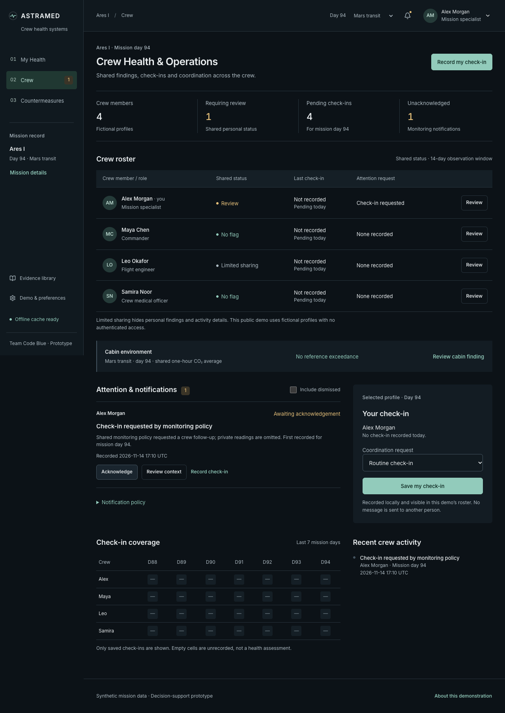

# ASTRAMED

Astronaut Health Monitoring System · Team Code Blue

ASTRAMED is Team Code Blue’s local-first astronaut health-monitoring and decision-support prototype, developed for the brief “Create Health Monitoring Software for Astronauts on Space Missions.” It uses fictional adults and reproducible synthetic measurements. It does not diagnose disease, prescribe treatment, determine fitness for duty, or replace flight surgeons.



## Run locally

Requires Node.js 22.12+ (tested with Node 25.1.0) and npm. From this directory:

```sh
npm ci
npm run dev
```

Open the URL printed by Vite (normally http://127.0.0.1:5173). No account, credentials, backend or remote API is required. The root project is independent of any other project folders in this workspace.

To test the production/offline build:

```sh
npm run build
npm run preview -- --port 4173
```

Open http://127.0.0.1:4173, allow its service worker to finish installing, and look for **Offline cache ready**. Offline support is intentionally enabled only for production builds. A local development server is not an offline demonstration.

## The demonstration

The welcome screen offers **Enter Mission System** (profile selection → mission briefing → workspace) and **Quick Demo**. The default is Alex Morgan, Mars transit, mission day 94, scenario B. Returning profiles can remember their briefing preference. Hash links such as `#/crew` and `#/countermeasures/cognitive` open directly. The profile menu supports switching, returning to selection and signing out while retaining records. The current synthetic reaction-time latency of 351 ms is compared with a seeded 285 ms baseline, yielding a calculated +23.2% change. Inspect the Health Card for the exact rule, persistence, sleep context, limitations and local NASA evidence record. Run the short reaction-response assessment in Countermeasures → Cognitive, save the result, and return to My Health to inspect the updated finding. Crew provides a roster, derived operational totals, shared detail panels, notifications with acknowledgement/dismissal, coordination requests, seven-day check-in coverage and saved activity history. No check-ins are fabricated or seeded. Scenario C changes the underlying cabin one-hour CO₂ average to 4.1 mmHg; the app calculates its 1.1 mmHg exceedance of the pinned 3 mmHg reference.

The optional voice setting reads the same deterministic finding. Scenario selection, mission-day replay, reset and JSON export are under **Demo & preferences** (also available through the profile menu or footer). Environment context remains in the header. Reset requires a confirmation; sign-out preserves records.

## Implemented features

- Welcome, fictional profile selection and mission briefing, followed by My Health, Crew and Countermeasures.
- Four fictional astronauts, 94 days of deterministic history and three scenarios.
- Profile/session menu, secondary simulation controls, four time windows and five hazard filters.
- Ten scalar indicators, including both blood-pressure components; charts with baselines, tooltips and a keyboard-accessible data table.
- Calculated Explainable Health Cards, local evidence viewer and original NASA source links.
- Validated manual readings with timestamp/unit metadata and locally saved results.
- Actual reaction-response timing, practice, five valid trials, false-start/timeout/hidden-tab exclusion, median aggregation and updated personal findings.
- Roster-based Crew operations with saved check-ins, support requests, acknowledgement history, shared detail panels and coverage timeline. Limited-sharing profiles omit personal status and activity details.
- Illustrative activity checklists with equipment context, completion totals, activity frequency, mission-day streaks and chronological assessment/activity history.
- Optional speech synthesis, local export/reset, versioned production service-worker caching.

## Scientific sources and data provenance

NASA science informs measurement selection, hazard context and the two pinned reference comparisons. All astronaut profiles, baselines, mission context and seeded measurements are synthetic; no NASA experimental observations are represented as crew telemetry. Manual readings are marked as user-reported, and task results as browser-timed. OSDR was investigated; no experimental dataset was incorporated because no matching personal monitoring dataset was selected.

Sources are recorded in [the evidence mapping](docs/scientific-sources/evidence-mapping.md). Core references include NASA Spaceflight Standard Measures, the HRP ISS psychomotor-vigilance task, OCHMO-TB-004 (citing NASA-STD-3001 Vol 2 Rev D V2 6004), and NASA-STD-3001 Vol 1 Rev C V1 4030. The app pins these references; it does not claim certification against the latest standard. The older Rev D PDF URL returned 404, so its accessible official technical brief is the evidence link.

The sleep, reaction-time and heart-rate percentage rules are **unvalidated Code Blue demonstration rules**, not NASA clinical thresholds. Environment changes affect displayed operational context, not physiological limits. “Nominal” means no implemented rule triggered, never medical clearance.

## Stack and architecture

React 19, TypeScript, Vite, Tailwind CSS 4, Lucide and Recharts. Styling, Inter fonts, icons and evidence are packaged locally; no third-party font requests are required. Domain calculations live outside presentation code. Browser localStorage persists prototype state. Native dialog provides modal focus handling; the task uses performance.now() and browser animation scheduling.

See [architecture](docs/implementation/architecture.md), [methodology](docs/implementation/methodology.md), [synthetic data](docs/implementation/synthetic-data.md), [limitations](docs/implementation/limitations.md), and [AI disclosure](docs/submission/ai-disclosure.md).

## Validation

```sh
npm test
npm run lint
npm run build
npm run test:e2e
```

The Playwright configuration uses locally installed Google Chrome (`channel: chrome`). Install Chrome or change that configuration to a Playwright Chromium installation (`npx playwright install chromium`). Browser tests launch the production preview on port 4173. They include a real timed five-trial response sequence, storage round trip, scenarios, crew actions, responsive screenshots, accessibility scans and an offline reload. Original release results are in [the validation record](docs/validation/results.md); the overhaul has a separate [review and validation record](docs/validation/redesign-review.md). Screenshots are generated by the responsive browser test.

## Deployment

The build is a static `dist/` directory. With a GitHub/Vercel account, publish the source, import the repository into Vercel, use `npm run build` and output directory `dist`, and select an appropriate Node version. A root-domain deployment needs no route rewrite because navigation is in-app. Subdirectory hosting is supported: build with `npm run build -- --base=/your-project/` and serve that same base path. Manifest assets and worker registration follow the base. Never publish real personal medical records or local browser exports.

[Deployment instructions](docs/submission/deployment.md) describe release checks. The approved source is public at [AliShahroor/astramed-prototype](https://github.com/AliShahroor/astramed-prototype), and the application is live on [GitHub Pages](https://alishahroor.github.io/astramed-prototype/). The included workflow verifies lint, tests and build before deployment. See the validation record for observed live-browser results. The separate existing astramed repository/site and local template copy are preserved. No competition submission has been performed. The [30-second storyboard](docs/submission/demo-storyboard.md) and [seven-slide outline](docs/submission/presentation-outline.md) prepare the submission; final competition rules and deadlines must be checked by the team.

## Team and disclosure

Team Code Blue · ASTRAMED. AI-assisted code, design, documentation and synthetic data generation are disclosed in [ai-disclosure.md](docs/submission/ai-disclosure.md). No NASA marks, generated astronaut images, model training claim or NASA endorsement are used. The prototype needs independent engineering, scientific and clinical review before any operational use.

## Isolated overhaul review

The product overhaul is on branch `redesign/operations-overhaul`, in a separate Git worktree created at the user’s request because another editor was working in the original folder. The branch is locally committed; it has not replaced the other checkout or the public deployment. See the review record for actual checks and integration notes.
